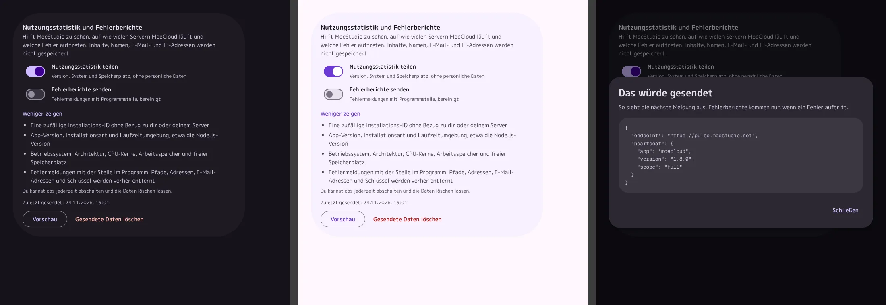

# MoePulse in eine Moe-App einbauen

Der Client ist eine einzige Datei ohne Abhängigkeiten. Er läuft in Node.js 22.12 oder neuer, also in allen Moe-Apps, egal ob ES-Module oder CommonJS. Ohne Einwilligung der Admins schickt er nichts und legt nichts an.

MoePulse selbst betreibt MoeStudio. Für die App brauchst du nur, was in diesem Repository liegt: den Client, auf Wunsch die React-Komponenten und diese Anleitung. Was der Client sendet, steht im [Protokoll](PROTOKOLL.md), was MoePulse davon speichert, unter [Datenschutz](DATENSCHUTZ.md).

## In sieben Schritten

1. Client in die App kopieren
2. Zwei Einstellungen anlegen, beide standardmäßig **aus**
3. Beim Serverstart `createPulse()` und `start()` aufrufen
4. Fehler aus dem Fehler-Handler an `pulse.capture()` geben
5. Im Admin-Bereich die Schalter mit Vorschau und „Daten löschen“ anbieten, dazu einen Absatz in der README
6. Support und Hinweise einbauen, damit Admins direkt aus der App schreiben können
7. Die Versionsprüfung auf MoePulse umstellen, statt GitHub direkt zu fragen

## 1. Client kopieren

| App ist …                        | Datei aus dem Repository  | Ziel in der App, zum Beispiel |
| -------------------------------- | ------------------------- | ----------------------------- |
| TypeScript mit Node-Typstripping | `sdk/src/moepulse.ts`     | `src/lib/moepulse.ts`         |
| JavaScript, ESM oder CommonJS    | `sdk/dist/moepulse.mjs`   | `src/lib/moepulse.mjs`        |
| dazu die Typen für JavaScript    | `sdk/dist/moepulse.d.mts` | `src/lib/moepulse.d.mts`      |

`sdk/dist` liegt fertig im Repository und passt immer zu `sdk/src`. Die Typen gehören direkt neben `moepulse.mjs` und müssen genauso heißen, nur mit `.d.mts`, sonst findet TypeScript sie nicht. Aus CommonJS lädst du die Datei mit `require('./lib/moepulse.mjs')`, das kann Node.js seit Version 22.12. Für TypeScript direkt in Node.js braucht die App Node.js 22.18 oder neuer.

Übernimm die Datei unverändert. Brauchst du etwas anderes, ändere den Client hier im Repository und kopier ihn danach neu, so bleiben alle Apps gleich. Wie du ihn baust und prüfst, steht in der [README des Clients](../README.md#am-client-arbeiten).

Die Datei gehört bewusst ins öffentliche Repository der App: So sieht jeder, was gesendet wird. Die Lizenz des Clients ist MIT.

## 2. Einstellungen

Zwei Schalter, beide aus, bis ein Admin sie einschaltet:

| Schlüssel      | Bedeutung                                                    |
| -------------- | ------------------------------------------------------------ |
| `pulse.stats`  | Nutzungsstatistik: Installation, Version, System, Kennzahlen |
| `pulse.errors` | Fehlerberichte                                               |

Zusätzlich versteht der Client zwei Umgebungsvariablen, mit denen Admins ihn fest abschalten oder umleiten können:

| Variable              | Wirkung                                                                |
| --------------------- | ---------------------------------------------------------------------- |
| `MOEPULSE_DISABLED=1` | Schickt nie etwas, egal was in den Einstellungen steht                 |
| `MOEPULSE_ENDPOINT`   | Andere Adresse für MoePulse, `off` schaltet ab wie `MOEPULSE_DISABLED` |

Zeig im Admin-Bereich an, wenn eine der beiden gesetzt ist, damit sich niemand über den wirkungslosen Schalter wundert.

## 3. Starten

```ts
import { createPulse } from './lib/moepulse.ts';

export const pulse = createPulse({
  app: 'moecloud',
  version: config.version,
  dataDir: config.dataDir,
  install: config.install,
  paths: { blobs: config.paths.blobs, thumbs: config.paths.thumbs },
  redact: () => [settings.get('site.url')].filter(Boolean),
  consent: () => ({ stats: settings.get('pulse.stats'), errors: settings.get('pulse.errors') }),
  features: () => ({ database: dialect(), scan: Boolean(config.clamav), language: settings.get('site.language') }),
  metrics: () => ({ users: countUsers(), files: countFiles(), bytes: usedBytes() }),
});

await pulse.start();
```

| Option     | Pflicht | Bedeutung                                                                                                                                     |
| ---------- | ------- | --------------------------------------------------------------------------------------------------------------------------------------------- |
| `app`      | ja      | Kennung der App in MoePulse: `moeshare`, `moecloud`, `moeauth`, `moecaptcha`, `moedns`, `moemail`, `moecalendar`. Neue Apps legt MoeStudio an |
| `version`  | ja      | Version der App                                                                                                                               |
| `dataDir`  | ja      | Beschreibbarer Ordner der App. Der Client legt darin `moepulse/` an, mit Identität und Absturzberichten                                       |
| `consent`  | ja      | Liefert `true`, `false` oder `{ stats, errors }`. Wird bei jedem Start und vor jeder Meldung gefragt                                          |
| `endpoint` | nein    | Adresse von MoePulse, Standard `https://pulse.moestudio.net`                                                                                  |
| `install`  | nein    | Installationsart, etwa `docker`, `node`, `script` oder `pm2`                                                                                  |
| `channel`  | nein    | Kanal, etwa `stable` oder `beta`                                                                                                              |
| `features` | nein    | Kurze Fakten über die Einrichtung: Zahlen, Wahrheitswerte oder kurze Texte. Keine Namen oder Adressen                                         |
| `metrics`  | nein    | Zahlen wie Konten oder Dateien                                                                                                                |
| `paths`    | nein    | Ordner mit Nutzerdaten. In Fehlermeldungen wird daraus `[name]/…`, Dateinamen verschwinden                                                    |
| `redact`   | nein    | Weitere Texte oder Muster, die nie gesendet werden sollen, etwa die eigene Domain                                                             |
| `root`     | nein    | Wurzel der App für relative Pfade in Programmstellen, Standard ist das Arbeitsverzeichnis                                                     |
| `crashes`  | nein    | Abstürze sichern und beim nächsten Start nachreichen, Standard `true`                                                                         |
| `identity` | nein    | Eigener Speicher für die Identität, siehe [Mehrere Server](#mehrere-server)                                                                   |
| `log`      | nein    | `(level, text) => void` für Hinweise des Clients                                                                                              |

Der Client meldet sich beim Start und dann im Abstand, den MoePulse vorgibt (Standard alle sechs Stunden, mit etwas Zufall). Seine Timer halten den Prozess nicht am Leben, und wenn MoePulse nicht erreichbar ist, merkt die App davon nichts.

Weitere Methoden:

| Methode                         | Wofür                                                                                       |
| ------------------------------- | ------------------------------------------------------------------------------------------- |
| `pulse.capture(error, context)` | Fehler melden, `context` sind kurze Fakten wie `{ route: 'POST /api/upload' }`              |
| `pulse.message(text, context)`  | Eine Warnung ohne Fehlerobjekt, etwa „Platte zu 95 % voll“                                  |
| `pulse.count(name, by)`         | Zähler hochzählen, etwa `pulse.count('upload')`. Kommt mit der nächsten Meldung mit         |
| `pulse.refresh()`               | Nach dem Umschalten der Einstellungen aufrufen                                              |
| `pulse.preview()`               | Zeigt, was gesendet würde, ohne etwas anzulegen                                             |
| `pulse.status()`                | Stand für den Admin-Bereich: Einwilligung, letzte Meldung, letzter Fehler                   |
| `pulse.forget()`                | Löscht alle Daten dieser Installation bei MoePulse und die lokale Identität                 |
| `pulse.flush(ms)`               | Offene Fehlerberichte sofort schicken, etwa vor dem Beenden                                 |
| `pulse.stop()`                  | Timer beenden und offene Berichte schicken                                                  |
| `pulse.support.*`               | Tickets anlegen, lesen, beantworten und schließen, siehe [Support](#6-support-und-hinweise) |
| `pulse.notices()`               | Laufende Hinweise für diese Version, kommen mit dem Heartbeat                               |
| `pulse.fetchNotices()`          | Hinweise einmal direkt abrufen, auch ohne Einwilligung                                      |
| `pulse.checkUpdate()`           | Fragt MoePulse nach neuen Versionen, anonym und ohne Einwilligung                           |
| `pulse.update()`                | Kurzfassung der letzten Prüfung oder des letzten Heartbeats, ohne Netzwerk                  |

Dazu `describe(language, appName)`: die Texte für die Einwilligung auf Deutsch oder Englisch, damit alle Apps dasselbe sagen.

## 4. Fehler melden

Melde nur echte Fehler, also Status 500 und Abstürze, keine falschen Passwörter oder 404.

**Fastify (MoeCloud)**

```ts
app.setErrorHandler((error, request, reply) => {
  const status = error.statusCode && error.statusCode >= 400 ? error.statusCode : 500;
  if (status >= 500) pulse.capture(error, { route: `${request.method} ${request.routeOptions.url ?? '?'}` });
});

process.on('unhandledRejection', (reason) => {
  app.log.error(reason, 'Unbehandelter Fehler');
  pulse.capture(reason, { origin: 'unhandledRejection' }, 'fatal');
});
```

**Express (MoeShare)**

```js
app.use((error, req, res, next) => {
  if (!error.status || error.status >= 500) pulse.capture(error, { route: `${req.method} ${req.route?.path ?? '?'}` });
  next(error);
});
```

**Hono (MoeCaptcha, MoeAuth, MoeDNS)**

```ts
app.onError((error, c) => {
  pulse.capture(error, { route: `${c.req.method} ${c.req.routePath}` });
  return c.json({ error: 'Da ist etwas schiefgegangen.' }, 500);
});
```

Abstürze durch nicht abgefangene Fehler erkennt der Client von selbst, ohne das Verhalten der App zu ändern: Er schreibt sie in `moepulse/crash-*.json` und schickt sie beim nächsten Start. Hat die App eigene Handler für `uncaughtException`, die den Prozess sauber beenden, ruf vorher `await pulse.flush(2000)` auf. Fängt die App `unhandledRejection` ab, gib den Grund wie oben an `pulse.capture()`.

Gib als `route` das Muster an (`/api/files/:id`), nie die echte Adresse. Personen- oder Dateinamen haben in `context` nichts verloren.

## 5. Einwilligung im Admin-Bereich

Drei kleine Endpunkte in der App reichen:

```ts
app.get('/api/admin/pulse', async (request) => ({
  texts: describe(request.lang === 'en' ? 'en' : 'de', 'MoeCloud'),
  value: { stats: settings.get('pulse.stats'), errors: settings.get('pulse.errors') },
  status: pulse.status(),
  locked: process.env.MOEPULSE_DISABLED === '1' || process.env.MOEPULSE_ENDPOINT === 'off',
}));

app.put('/api/admin/pulse', async (request) => {
  settings.set('pulse.stats', request.body.stats === true);
  settings.set('pulse.errors', request.body.errors === true);
  await pulse.refresh();
  return { ok: true, status: pulse.status() };
});

app.get('/api/admin/pulse/preview', async () => pulse.preview());

app.post('/api/admin/pulse/forget', async () => {
  const done = await pulse.forget();
  if (done) {
    settings.set('pulse.stats', false);
    settings.set('pulse.errors', false);
  }
  return { ok: done };
});
```

Für die Oberfläche gibt es eine fertige Karte mit MUI: `sdk/react/PulseConsent.tsx`. Kopier sie in die App und nutze sie zum Beispiel unter **Admin › System**:

```tsx
import { PulseConsent } from './PulseConsent';

<PulseConsent
  texts={data.texts}
  value={data.value}
  status={data.status}
  disabled={data.locked}
  onChange={async (value) => setData(await api.put('/api/admin/pulse', value))}
  preview={() => api.get('/api/admin/pulse/preview')}
  onForget={async () => (await api.post('/api/admin/pulse/forget')).ok}
/>;
```



Die Karte übernimmt das Theme der App, also Material You im Moe-Look. Sie zeigt beide Schalter, auf Wunsch die Liste der gesendeten Daten, die Vorschau als JSON und „Gesendete Daten löschen“.

Im Installationsassistenten kannst du die Frage gleich mit stellen, beide Schalter aber nie vorab einschalten.

## 6. Support und Hinweise

Admins schreiben MoeStudio direkt aus der App, die Antwort erscheint wieder in der App. Das klappt auch ohne Einwilligung für die Statistik: Beim ersten Ticket legt der Client eine Identität an, die Installation zählt dann nur für den Support.

Dazu kommen **Hinweise**, die MoeStudio veröffentlicht, etwa ein Sicherheitsupdate nur für Versionen bis 1.8.0.

### Ein Weg im Backend

Der Browser darf MoePulse nie direkt ansprechen, sonst bräuchte er den Schlüssel. Die App reicht die Anfragen über einen eigenen Weg durch, `handleSupport()` erledigt den Rest:

**Fastify (MoeCloud)**

```ts
import { handleSupport } from './lib/moepulse.ts';

app.post('/api/admin/moepulse/support', { preHandler: [requireAdmin] }, async (request, reply) => {
  const result = await handleSupport(pulse, request.body);
  return reply.code(result.status).send(result.body);
});
```

**Express (MoeShare)**

```js
const { handleSupport } = require('./lib/moepulse.mjs');

app.post('/api/admin/moepulse/support', requireAdmin, express.json({ limit: '32kb' }), async (req, res) => {
  const result = await handleSupport(pulse, req.body);
  res.status(result.status).json(result.body);
});
```

**Hono (MoeCaptcha, MoeAuth, MoeDNS)**

```ts
app.post('/api/admin/moepulse/support', requireAdmin, async (c) => {
  const result = await handleSupport(pulse, await c.req.json().catch(() => ({})));
  return c.json(result.body, result.status as 200);
});
```

Wichtig: Der Weg gehört hinter die Admin-Anmeldung und den CSRF-Schutz der App. Wer ihn aufrufen kann, schreibt im Namen der Installation.

`handleSupport` versteht `{ action: 'list' }`, `{ action: 'get', id }`, `{ action: 'create', input }`, `{ action: 'reply', id, message }`, `{ action: 'close', id }` und `{ action: 'notices' }`. Fehler kommen mit passendem Status und einer deutschen Meldung zurück, etwa `429` mit „Gerade kommen zu viele Nachrichten an“.

### Im Admin-Bereich

Kopier den ganzen Ordner `sdk/react` in die App, etwa nach `src/moepulse/`. Er enthält alle Komponenten, `client.ts` mit `createSupportClient()` und `index.ts` zum Importieren. Die Komponenten brauchen nur React 19 und MUI 9 und übernehmen das Theme der App:

```tsx
import { createSupportClient, PulseNotices, PulseSupport } from './moepulse';

const support = createSupportClient('/api/admin/moepulse/support', {
  headers: () => ({ 'x-csrf-token': csrfToken() }),
});

export function HelpPage({ admin, settings }: Props) {
  return (
    <Stack spacing={2}>
      <PulseNotices load={support.notices} />
      <Card sx={{ p: 3 }}>
        <PulseSupport
          support={support}
          developer="Max von MoeStudio"
          defaults={{ name: admin.name, email: admin.email }}
          diagnostics={settings.pulse.stats}
          onUnread={setUnreadBadge}
        />
      </Card>
    </Stack>
  );
}
```

| Eigenschaft   | Bedeutung                                                                      |
| ------------- | ------------------------------------------------------------------------------ |
| `support`     | Der Client von `createSupportClient()` oder ein eigener mit denselben Methoden |
| `developer`   | So heißt MoeStudio in den Antworten, Standard „MoeStudio“                      |
| `defaults`    | Name und E-Mail zum Vorausfüllen, beides bleibt freiwillig                     |
| `diagnostics` | Ob der Haken „Diagnose mitsenden“ gesetzt ist, am besten wie die Statistik     |
| `privacy`     | Eigener Satz zum Datenschutz unter dem Formular, `{dev}` wird ersetzt          |
| `poll`        | Wie oft ein offenes Ticket neu geladen wird, Standard 60 Sekunden              |
| `onUnread`    | Bekommt die Zahl der ungelesenen Antworten, etwa für ein Badge im Menü         |
| `language`    | `de` oder `en`                                                                 |

`PulseNotices` zeigt laufende Hinweise als Banner. Info und Wichtig lassen sich ausblenden, Sicherheit nicht, die verschwinden erst mit dem Update. Mit `notices={pulse.notices()}` aus dem Backend geht es auch ohne `load`. Gut passt das Banner auf die Startseite des Admin-Bereichs.

Ein Badge im Menü bekommst du auch ohne Komponente: Nach jedem Heartbeat liefert `pulse.support.unread()` die Zahl der neuen Antworten.

### Was die Admins sehen sollten

Ergänze den Absatz in der README um einen Satz:

> Unter **Admin › Hilfe** kannst du MoeStudio direkt schreiben. Gesendet werden deine Nachricht, die Version und auf Wunsch Name, E-Mail und eine bereinigte Diagnose. Löschst du die gesendeten Daten, verschwinden auch deine Nachrichten.

> Under **Admin › Help** you can write to MoeStudio directly. It sends your message, the version and, if you want, your name, email and cleaned diagnostics. Deleting sent data removes your messages as well.

## 7. Versionsprüfung über MoePulse

Bisher fragen die Apps GitHub, ob es eine neue Version gibt. Ab jetzt fragen sie MoePulse. MoePulse holt die Versionen selbst aus GitHub und von der Changelog-Seite der App und gibt sie weiter. Das hat drei Vorteile:

- GitHub sieht die Server der Admins nicht mehr, und das Limit von 60 Abrufen pro Stunde trifft nur noch MoePulse.
- MoeStudio bestimmt, was angeboten wird: Versionen zurückhalten, zurückziehen oder als Sicherheitsupdate markieren.
- Die Notizen kommen gleich mit, so wie sie auf der Changelog-Seite stehen.

### Quellen

Die Quellen trägt MoeStudio in MoePulse ein: das GitHub-Repository der App und ihre Changelog-Seite. Die Seite braucht pro Version eine Überschrift mit der Nummer, darunter Datum und Notizen, so wie bei MoeShare und MoeCloud. Markdown im Stil von Keep a Changelog und JSON gehen auch. Steht eine Version schon im Changelog, aber noch nicht auf GitHub, bietet MoePulse sie erst nach dem Release an.

### In der App

Auf dem Server der App:

```ts
const update = await pulse.checkUpdate();

if (update?.update) {
  log.info(`${update.latest.version} ist da`, { security: update.security });
}
```

`checkUpdate()` schickt nur App, Version und Kanal mit, keine Kennung, und braucht keine Einwilligung. Das Ergebnis bleibt zehn Minuten im Speicher. Ist MoePulse nicht erreichbar oder mit `MOEPULSE_DISABLED=1` abgeschaltet, kommt `null` zurück, dann kann die App wie bisher bei GitHub nachsehen.

| Feld       | Bedeutung                                                     |
| ---------- | ------------------------------------------------------------- |
| `latest`   | Neueste angebotene Version mit Titel, Datum, Link und Notizen |
| `update`   | Ob die laufende Version älter ist                             |
| `security` | Ob unter den neueren Versionen ein Sicherheitsupdate ist      |
| `yanked`   | Ob die laufende Version zurückgezogen wurde                   |
| `releases` | Alle neueren Versionen, neueste zuerst, höchstens zehn        |

Installationen mit Einwilligung bekommen eine Kurzfassung schon mit dem Heartbeat. `pulse.update()` liefert sie ohne Netzwerk, gut für ein Badge im Menü.

Im Admin-Bereich zeigt `PulseUpdate` die Prüfung mit Notizen. Es nutzt denselben Weg wie der Support:

```tsx
import { PulseUpdate } from './moepulse';

<PulseUpdate
  load={support.update}
  app="MoeShare"
  instructions={
    <>
      <code>docker compose pull</code> und danach <code>docker compose up -d</code>
    </>
  }
/>;
```

Steht in der README der App, dass die Versionsprüfung „ohne Angaben über deinen Server“ läuft, bleibt das richtig. Wechsle nur den Namen von GitHub zu MoeStudio.

## Mehrere Server

Läuft eine App auf mehreren Servern mit gemeinsamer Datenbank (etwa MoeCaptcha mit `compose.scale.yaml`), soll sie als **eine** Installation zählen. Dann die Identität in der Datenbank statt im Datenordner ablegen:

```ts
createPulse({
  identity: {
    load: () => settings.get('pulse.identity') || null,
    save: (value) => settings.set('pulse.identity', value),
    clear: () => settings.set('pulse.identity', ''),
  },
});
```

Mehrere Prozesse auf einem Server, etwa mit PM2 im Cluster-Modus, brauchen nichts davon: Sie teilen sich die Datei im Datenordner. MoePulse fasst ihre Meldungen zusammen.

## Kennzahlen und Zähler

Gute Kandidaten:

| App        | `features`                               | `metrics`                          | `count()`                   |
| ---------- | ---------------------------------------- | ---------------------------------- | --------------------------- |
| MoeShare   | `database`, `storage`, `sso`, `language` | `users`, `files`, `bytes`, `links` | `upload`, `paste`, `link`   |
| MoeCloud   | `database`, `scan`, `language`           | `users`, `files`, `bytes`, `teams` | `upload`, `share`, `webdav` |
| MoeCaptcha | `database`, `valkey`                     | `sites`                            | `solved`, `failed`          |
| MoeAuth    | `database`, `proxy`                      | `users`, `clients`                 | `login`                     |
| MoeDNS     | `providers`                              | `zones`                            | `sync`                      |
| MoeMail    | `database`, `archive`                    | `mailboxes`, `users`               | `sent`                      |

Nie: Namen, E-Mail-Adressen, Domains, Dateinamen, Inhalte. Halte `features` kurz, MoePulse zeigt jede Kombination als Verteilung an.

## Absatz für die README der App

> ### Nutzungsstatistik und Fehlerberichte
>
> Auf Wunsch schickt {App} anonyme Nutzungsdaten und Fehlerberichte an MoeStudio. Beides ist ausgeschaltet, bis du es unter **Admin › System** einschaltest. Gesendet werden eine zufällige Installations-ID, die Version, Betriebssystem, Architektur, Arbeitsspeicher, freier Speicherplatz, Zeitzone und Anzahlen wie Konten oder Dateien. Fehlerberichte enthalten die Fehlermeldung und die Stelle im Programm, Pfade, Adressen und Schlüssel werden vorher entfernt. Inhalte, Namen, E-Mail- und IP-Adressen speichert MoeStudio nicht. Was genau gesendet würde, zeigt die Vorschau. Mit „Gesendete Daten löschen“ verschwindet alles wieder. Mit `MOEPULSE_DISABLED=1` schaltest du die Funktion fest ab.

> ### Usage statistics and error reports
>
> If you want, {App} sends anonymous usage data and error reports to MoeStudio. Both are off until you turn them on under **Admin › System**. It sends a random installation ID, the version, operating system, architecture, memory, free disk space, time zone and counts such as accounts or files. Error reports contain the error message and the place in the code, paths, addresses and keys are removed first. MoeStudio does not store content, names, email or IP addresses. The preview shows exactly what would be sent. „Delete sent data“ removes everything again. Set `MOEPULSE_DISABLED=1` to turn the feature off for good.

Wo die App bisher etwas anderes verspricht, etwa MoeCloud mit „ohne Angaben über deinen Server“ bei der Versionsprüfung, bleibt das richtig: Auch über MoePulse läuft sie ohne Kennung und ohne Einwilligung, nur fragt die App jetzt MoeStudio statt GitHub. Nutzungsstatistik und Fehlerberichte sind davon getrennt und bleiben freiwillig.

## Checkliste

- [ ] Client kopiert, `app` passt zur Kennung in MoePulse
- [ ] `pulse.stats` und `pulse.errors` stehen standardmäßig auf aus
- [ ] `consent` liest die Einstellungen, `refresh()` nach jeder Änderung
- [ ] Fehler-Handler meldet nur Status 500 und Abstürze
- [ ] `paths` enthält alle Ordner mit Nutzerdaten, `redact` die eigene Domain
- [ ] Admin-Bereich mit Schaltern, Vorschau und „Gesendete Daten löschen“
- [ ] Absatz in der README und im Changelog
- [ ] Einmal mit Einwilligung starten, `pulse.status()` zeigt die letzte Meldung ohne Fehler
- [ ] Weg für `handleSupport` hinter Admin-Anmeldung und CSRF-Schutz
- [ ] `PulseSupport` und `PulseNotices` im Admin-Bereich, ein Testticket geschrieben und die Antwort in der App gesehen
- [ ] Repository und Changelog-Seite an MoeStudio gegeben, Versionsprüfung auf `pulse.checkUpdate()` umgestellt, `PulseUpdate` im Admin-Bereich
